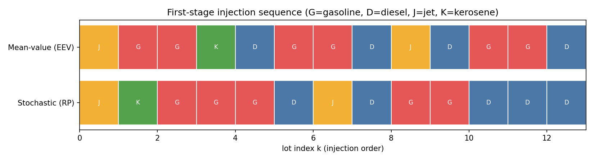

# Multiproduct Pipeline Batch Scheduling under Uncertainty (Pyomo, Two-Stage Stochastic MILP)

Oil & gas (downstream) case study: schedule the **order of product batches** (gasoline, diesel, jet fuel, kerosene) in a refinery-to-depot pipeline when **pump outages and demand are uncertain**. Formulated as a **two-stage stochastic mixed-integer linear program** in Pyomo and solved with HiGHS.



## Problem in one paragraph
Lots are pumped through one pipe in FIFO order. Different adjacent products create costly *interfaces*. The depot holds finite tanks. **Stage 1** (before uncertainty): choose the product of each lot. **Stage 2** (per scenario): inventory, sales, unmet demand, spills. Pump outages delay deliveries; demand is random. Full derivation: [`docs/THEORY.md`](docs/THEORY.md).

## Results (synthetic data, 20 planning scenarios, 100 test scenarios)

| Metric (expected cost, $) | baseline | tight buffers |
|---|---:|---:|
| RP (stochastic) | 196,753 | 237,328 |
| WS (perfect information) | 170,825 | 208,761 |
| EEV (mean-value plan) | 196,813 | 255,000 |
| **EVPI** = RP − WS | 25,928 | 28,566 |
| **VSS** = EEV − RP | 60 | **17,672** (~7%) |
| Out-of-sample, stochastic plan | 184,431 | **248,494** |
| Out-of-sample, mean-value plan | 183,575 | 262,524 |

**How to read this honestly.** With generous depot buffers (`baseline`) the average-demand schedule is already robust and VSS (60) is below the 2% MIP-gap noise, so there is no benefit. With thin buffers, longer outages and higher volatility (`tight`), modelling uncertainty cuts expected cost by ~7% in-sample and ~5% on unseen scenarios. The value of stochastic programming depends on how much slack the system has.

## Run it
```bash
python -m venv .venv && source .venv/bin/activate   # Windows: .venv\Scripts\activate
pip install -r requirements.txt
python run_experiment.py --case tight      # or: --case baseline   (about 1-2 minutes)
python -m pytest -q                        # sanity tests (WS <= RP <= EEV)
```
Outputs go to `results/`.

## Layout
```
pipesched/data.py      instance data + scenario generator
pipesched/model.py     Pyomo two-stage stochastic MILP (extensive form)
pipesched/analysis.py  RP, WS, EEV, EVPI, VSS, out-of-sample evaluation
pipesched/plots.py     sequence and metric figures
run_experiment.py      CLI entry point
docs/THEORY.md         tutorial: the maths and every constraint
tests/                 pytest sanity checks
```

## Scope and limitations (please read)
* **All data are synthetic/illustrative.** This repo implements an original, simplified discrete-time model of the *problem class* studied in the literature below. It does **not** reproduce any paper's formulation or numerical results.
* Straight pipeline, single depot, unit lot sizes, no pump-energy or flow-rate variables, no intermediate deliveries.
* 2% MIP gap and a 16-slot horizon for tractability.

## References
Problem class and motivation (see `references.bib`; entries marked VERIFY need volume/pages checked):
1. N. Beheshti Asl, S. A. MirHassani (2019). *Benders decomposition with integer sub-problem applied to pipeline scheduling problem under flow rate uncertainty.* Computers & Chemical Engineering.
2. A. Baghban, P. M. Castro, F. Oliveira (2025). *Data-driven robust optimization for pipeline scheduling under flow rate uncertainty.* Computers & Chemical Engineering 193, 108924.
3. M. Taherkhani, R. Tavakkoli-Moghaddam, M. Seifbarghy, P. Fattahi (2017). *Detailed Scheduling of Tree-like Pipeline Networks with Multiple Refineries.* Int. J. Engineering 30(12).
4. H. Mostafaei, P. M. Castro, A. Ghaffari-Hadigheh (2015). *A novel monolithic MILP framework for lot-sizing and scheduling of multiproduct treelike pipeline networks.* Ind. Eng. Chem. Res. 54(37), 9202–9221.
5. S. Moradi, S. A. MirHassani (2016). *Robust scheduling for multi-product pipelines under demand uncertainty.* Int. J. Adv. Manuf. Technol. 87, 2541–2549.
6. J. R. Birge, F. Louveaux (2011). *Introduction to Stochastic Programming*, 2nd ed., Springer.

## License
MIT (see `LICENSE`; replace `Dhvani Shukla`).
